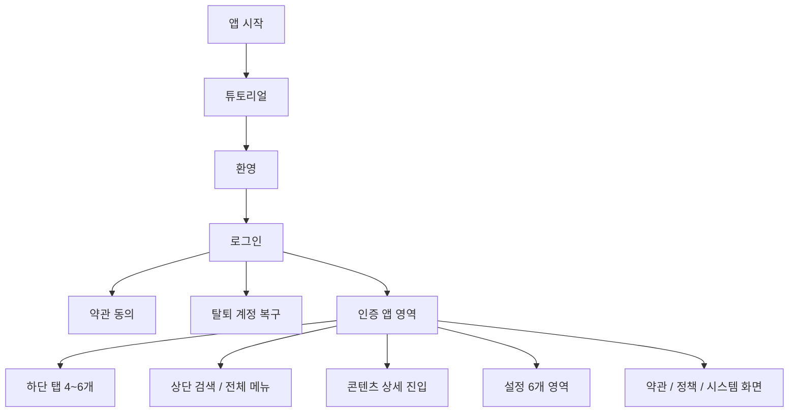

# Divergram App Interface Architecture

> 기준: 2026-08-13 실제 `app/app` 파일 라우트, `appSitemap`, 하단 탭, 헤더 전체 메뉴, 설정 상세 모드 대조

## 1. 전체 구조 요약



## 2. 전역 내비게이션

### 2.1 하단 탭

- 기본 5개: 피드, 탐색, 포인트 지도, 로그 작성, 프로필
- 선택 가능 15개: 피드, 탐색, 포인트 지도, 로그 작성, 프로필, 릴스, 메시지, 알림, 리조트, 즐겨찾기, 스탬프, 라이선스 관리, 내 활동, 설정, 후원하기
- 제약: 최소 4개, 최대 6개, 피드는 필수
- 저장: 사용자 설정과 서버 동기화 대상

### 2.2 상단 헤더

- 로고: 피드로 이동
- 검색: 통합 검색
- 햄버거: 전체 메뉴 모달
- 전체 메뉴 기본 11개: 메시지, 설정, 내 활동, 릴스, 리조트, 다이빙 교육, 포인트 지도, 스탬프, 알림, 라이선스 관리, 앱 정보
- 관리자 계정: 관리자 메뉴 추가
- 배열: 가로 3개, 길게 눌러 순서 변경, 순서 저장

## 3. 사용자 메뉴 아키텍처

### A. 가입과 인증

1. 앱 시작 분기 `/`
2. 튜토리얼 `/(auth)/tutorial`
3. 환영 `/(auth)/welcome`
4. 로그인 `/(auth)/login`
5. 가입 약관 동의 `/(auth)/consent`
6. 이용약관 `/(auth)/terms`
7. 개인정보처리방침 `/(auth)/privacy`
8. 동적 약관 문서 `/(auth)/policy-document`
9. 탈퇴 계정 복구 `/(auth)/account-recovery`
10. Google OAuth 콜백 `/(auth)/callback/google`
11. Apple OAuth 콜백 `/(auth)/callback/apple`
12. Instagram OAuth 콜백 `/(auth)/callback/instagram`
13. Facebook OAuth 콜백 `/(auth)/callback/facebook`
14. Kakao OAuth 콜백 `/(auth)/callback/kakao` (현재 사용자 로그인 메뉴에서는 제외된 레거시 콜백)
15. Naver OAuth 콜백 `/(auth)/callback/naver` (현재 사용자 로그인 메뉴에서는 제외된 레거시 콜백)

### B. 피드와 콘텐츠

1. 피드 `/(tabs)` 또는 `/(tabs)/feed`
2. 게시물 작성 진입 `/(tabs)/create` → 현재 로그 작성 화면으로 연결
3. 게시물 상세 `/(tabs)/post?post=`
4. 릴스 `/(tabs)/reels`
5. 탐색 `/(tabs)/explore`
6. 통합 검색 `/(tabs)/search`
7. 저장 콘텐츠 `/(tabs)/saved`
8. 내 활동 `/(tabs)/activity`
9. 게시물·사용자 신고 `/(tabs)/report`

### C. 다이빙 로그와 장비

1. 로그 작성·목록 `/(tabs)/logs`
2. DiveLog 관리 `/(tabs)/dive-log-management`
3. DiveLog 상세 `/(tabs)/dive-log-detail`
4. DiveLog 편집 `/(tabs)/dive-log-edit`
5. 다이빙 컴퓨터 관리 `/(tabs)/bluetooth-devices`
6. 장비 관리 별칭 `/(tabs)/devices` → 다이빙 컴퓨터 관리
7. 외부 서비스 연동 `/(tabs)/integration-settings`
8. 해양 날씨 `/(tabs)/marine-weather`
9. 자격증·레벨 관리 `/(tabs)/certifications`
10. 라이선스 관리 `/(tabs)/license-management`
11. 다이빙 교육 `/(tabs)/dive-education`
12. 스탬프 `/(tabs)/stamps`

### D. 지도와 리조트

1. 포인트 지도 `/(tabs)/location`
2. 리조트 목록 `/(tabs)/resorts`
3. 리조트 상세 `/(tabs)/resort-detail?resortId=`
4. 리조트 상세 탭: 소개, 가격, 편의시설, 리뷰
5. 해양 날씨 지역 관리 `/(tabs)/marine-weather`

### E. 커뮤니티와 커뮤니케이션

1. 알림함 `/(tabs)/notifications`
2. 알림 세부 설정 `/(tabs)/notification-settings`
3. 1:1 메시지·대화방 목록 `/(tabs)/messages`
4. 그룹 채팅 생성·대화 `/(tabs)/messages?roomId=`
5. 다른 사용자 프로필 `/(tabs)/account?userId=`
6. 팔로우·팔로워 목록: 프로필 내부 시트

### F. 내 프로필

1. 내 프로필 `/(tabs)/profile`
2. 프로필 수정 `/(tabs)/profile-edit`
3. 프로필 내부 탭: 피드, 릴스, 리조트, 즐겨찾기
4. 통계: 팔로우, 팔로워, 총 다이빙, 총 시간
5. 교육 신청 내역
6. 다이빙 기록 목록
7. 라이선스 요약

### G. 설정

1. 설정 홈 `/(tabs)/settings`
2. 계정 설정
   - 프로필 설정
   - Google, Apple(iOS), Instagram, Facebook 계정 연동
   - Instagram·Facebook 교차 게시
   - 외부 서비스 연동
   - DiveLog 관리
   - 다이빙 컴퓨터 관리
   - 로그아웃
3. 알림 설정
   - 전체 푸시
   - 좋아요, 댓글, 팔로우, 이벤트
   - 알림 상세
4. 공개 범위 설정
   - 프로필 공개
   - 게시물 공개 범위
   - 다이빙 로그 공개 범위
   - 위치 공유
   - 차단 사용자
   - 광고 개인정보 설정
5. 다이빙 설정
   - 자격증·레벨
   - 라이선스
   - 장비·기기
   - 외부 서비스
   - 해양 날씨
   - 활동지역·관심 포인트
   - DiveLog 관리
   - 단위 설정
6. 앱 설정
   - 테마
   - 언어
   - AI 설정
   - 후원하기
   - 하단 메뉴 관리
   - 캐시 삭제
7. 안전 설정
   - 비상 연락처
   - 긴급 상황 공유
   - 다이빙 안전 가이드
   - 보험 정보

### H. 설정 상세 모드

단일 라우트 `/(tabs)/settings-detail?mode=`가 아래 12개 인터페이스를 제공합니다.

1. `link-google`
2. `link-apple`
3. `link-instagram`
4. `link-facebook`
5. `account-delete`
6. `blocked-users`
7. `customer-center`
8. `unit-settings`
9. `emergency-contact`
10. `safety-guide`
11. `insurance`
12. `bottom-menu`

### I. 앱 정보와 정책

1. 앱 정보 `/(tabs)/app-info`
2. 정책 센터 `/(tabs)/policy-center`
3. 동적 정책 문서 `/(tabs)/policy-document`
4. 이용약관 `/(tabs)/terms-policy`
5. 개인정보처리방침 `/(tabs)/privacy-policy`
6. 위치정보 이용약관 `/(tabs)/location-policy`
7. 커뮤니티 운영정책 `/(tabs)/community-policy`
8. 안전 고지 `/(tabs)/safety-disclaimer`
9. AI 사용 안내 `/(tabs)/ai-usage-policy`
10. 오픈소스 라이선스 `/(tabs)/open-source-licenses`
11. 후원하기 `/(tabs)/donate`
12. 고객 문의·신고 `/(tabs)/report`

### J. 운영과 시스템

1. 앱 내 관리자 대시보드 `/(tabs)/admin` (관리자만 전체 메뉴에 노출)
2. 존재하지 않는 경로 `+not-found`
3. Expo 개발 클라이언트 리다이렉트 `/expo-development-client`
4. 인증 보호: 미로그인 사용자는 로그인 화면으로 이동
5. 탈퇴 대기 보호: 계정 복구 화면 외 이동 차단

## 4. 실제 파일 라우트 인벤토리

| 영역 | 실제 화면 파일 | 수량 |
|---|---|---:|
| 루트·시스템 | `index`, `expo-development-client`, `+not-found` | 3 |
| 인증 사용자 화면 | tutorial, welcome, login, consent, terms, privacy, policy-document, account-recovery | 8 |
| OAuth 콜백 | google, apple, instagram, facebook, kakao, naver | 6 |
| 인증 후 탭 그룹 | `_layout` 제외 실제 `.tsx` 화면 | 46 |
| 설정 상세 내부 모드 | settings-detail 한 화면 내부 | 12 |

주의: 파일 수와 사용자 화면 수는 같지 않습니다. `index/feed`, `create/logs`, `devices/bluetooth-devices`는 별칭 또는 재사용 관계이며, 설정 상세는 한 파일에서 12개 모드를 제공합니다.

## 5. 중앙 사이트맵 대조 결과

- `appSitemap` 등록 항목: 51개
- 실제 파일에 있으나 중앙 사이트맵에서 직접 관리하지 않는 주요 항목: 가입 약관 동의, 탈퇴 계정 복구, 동적 인증 약관, OAuth 콜백 6종, Expo 개발 리다이렉트, Not Found
- 현재 사용자 로그인 정책: Google, Apple, Instagram 중심이며 Facebook은 설정 연동에 존재
- 레거시 콜백: Kakao, Naver 파일은 남아 있으나 로그인 UI에서는 사용하지 않음

## 6. 유지보수 원칙

1. 새 화면 추가 시 파일 라우트와 `appSitemap`을 동시에 갱신합니다.
2. 하단 메뉴 후보는 `bottomTabCandidates`와 탭 아이콘 메타를 함께 갱신합니다.
3. 전체 메뉴는 `headerMenuDefault`, `iconMap`, `appRouteMap`을 함께 갱신합니다.
4. 설정 상세 모드 추가 시 `DetailMode`, `asMode`, 제목·설명·콘텐츠 렌더링을 함께 갱신합니다.
5. 기능 또는 모듈 삭제는 사용자 승인 없이 진행하지 않습니다.

## 7. 전체 Expo Router 파일 부록

아래는 `app/app` 아래의 `.tsx` 파일 **총 68개**를 전부 대조한 목록입니다. 사용자에게 직접 보이는 화면뿐 아니라 화면 전환을 담당하는 레이아웃과 공용 OAuth 콜백 구현도 포함합니다.

### 7.1 루트와 공용 레이아웃 (4)

| 파일 | 역할 |
|---|---|
| `app/app/_layout.tsx` | 앱 최상위 레이아웃, 초기화와 전역 내비게이션 |
| `app/app/index.tsx` | 앱 시작 분기 |
| `app/app/expo-development-client.tsx` | Expo 개발 클라이언트 진입 처리 |
| `app/app/+not-found.tsx` | 존재하지 않는 경로 처리 |

### 7.2 인증 영역 (17)

| 파일 | 역할 |
|---|---|
| `app/app/(auth)/_layout.tsx` | 인증 화면 레이아웃 |
| `app/app/(auth)/tutorial.tsx` | 튜토리얼 |
| `app/app/(auth)/welcome.tsx` | 환영 화면 |
| `app/app/(auth)/login.tsx` | 로그인 |
| `app/app/(auth)/consent.tsx` | 회원가입 약관 동의 |
| `app/app/(auth)/terms.tsx` | 이용약관 |
| `app/app/(auth)/privacy.tsx` | 개인정보처리방침 |
| `app/app/(auth)/policy-document.tsx` | 동적 약관 문서 |
| `app/app/(auth)/account-recovery.tsx` | 탈퇴 계정 복구 |
| `app/app/(auth)/callback/_layout.tsx` | OAuth 콜백 레이아웃 |
| `app/app/(auth)/callback/CallbackScreen.tsx` | OAuth 콜백 공용 구현 |
| `app/app/(auth)/callback/google.tsx` | Google 콜백 |
| `app/app/(auth)/callback/apple.tsx` | Apple 콜백 |
| `app/app/(auth)/callback/instagram.tsx` | Instagram 콜백 |
| `app/app/(auth)/callback/facebook.tsx` | Facebook 콜백 |
| `app/app/(auth)/callback/kakao.tsx` | Kakao 레거시 콜백 |
| `app/app/(auth)/callback/naver.tsx` | Naver 레거시 콜백 |

### 7.3 인증 후 탭 영역 (47)

| 파일 | 화면 또는 역할 |
|---|---|
| `app/app/(tabs)/_layout.tsx` | 탭·인증 보호 레이아웃 |
| `account.tsx` | 계정 정보 |
| `activity.tsx` | 내 활동 |
| `admin.tsx` | 앱 내 관리자 |
| `ai-settings.tsx` | AI 설정 |
| `ai-usage-policy.tsx` | AI 사용 안내 |
| `app-info.tsx` | 앱 정보 |
| `bluetooth-devices.tsx` | 다이빙 컴퓨터 관리 |
| `certifications.tsx` | 자격증·레벨 |
| `community-policy.tsx` | 커뮤니티 정책 |
| `create.tsx` | 로그 작성 별칭 |
| `devices.tsx` | 장비 관리 별칭 |
| `dive-education.tsx` | 다이빙 교육 |
| `dive-log-detail.tsx` | 다이빙 로그 상세 |
| `dive-log-edit.tsx` | 다이빙 로그 편집 |
| `dive-log-management.tsx` | 다이빙 로그 관리 |
| `donate.tsx` | 후원하기 |
| `explore.tsx` | 탐색 |
| `feed.tsx` | 피드 구현 |
| `index.tsx` | 기본 피드 탭 |
| `integration-settings.tsx` | 외부 서비스 연동 |
| `license-management.tsx` | 라이선스 관리 |
| `location-policy.tsx` | 위치정보 이용약관 |
| `location.tsx` | 포인트 지도 |
| `logs.tsx` | 로그 작성·목록 |
| `marine-weather.tsx` | 해양 날씨 |
| `messages.tsx` | 메시지·그룹 채팅 |
| `notification-settings.tsx` | 알림 설정 |
| `notifications.tsx` | 알림함 |
| `open-source-licenses.tsx` | 오픈소스 라이선스 |
| `policy-center.tsx` | 정책 센터 |
| `policy-document.tsx` | 정책 상세 문서 |
| `post.tsx` | 게시물 상세 |
| `privacy-policy.tsx` | 개인정보처리방침 |
| `profile-edit.tsx` | 프로필 편집 |
| `profile.tsx` | 내·다른 사용자 프로필 |
| `reels.tsx` | 릴스 |
| `report.tsx` | 신고·고객 문의 |
| `resort-detail.tsx` | 리조트 상세 |
| `resorts.tsx` | 리조트 목록 |
| `safety-disclaimer.tsx` | 안전 고지 |
| `saved.tsx` | 즐겨찾기 |
| `search.tsx` | 통합 검색 |
| `settings-detail.tsx` | 설정 상세 12개 모드 |
| `settings.tsx` | 설정 홈 |
| `stamps.tsx` | 스탬프 |
| `terms-policy.tsx` | 이용약관 |

### 7.4 완전성 검증 결과

- 실제 `.tsx` 파일: **68개**
- 루트와 공용 레이아웃: **4개**
- 인증 영역: **17개**
- 탭 영역: **47개** (`_layout` 1개 + 화면 46개)
- 합계: **4 + 17 + 47 = 68개**
- 사용자 화면 별칭과 내부 모드를 별도로 표시했으며, 기능 삭제 없이 현재 구조를 문서화했습니다.

## 8. 프로젝트 디렉터리 아키텍처

```text
divergram/
├── app/         Expo Router 기반 iOS·Android 앱
├── api/         Express API, PostgreSQL 접근, 큐 작업자
├── adm/         Vite 기반 운영 관리자 웹
├── web/         Vite 기반 사용자 웹
├── site/        divergram.com 정적 사이트와 앱·웹 딥링크 파일
├── docs/        설계, 감사, 배포, 운영 문서
├── scripts/     모노레포 공통 점검·배포 보조 스크립트
├── artifacts/   시뮬레이터 캡처와 테스트 산출물
└── tools/       개발·검증 도구
```

| 디렉터리 | 책임 | 주요 진입점 |
|---|---|---|
| `app/` | 모바일 UI, 기기 기능, 푸시, AdMob, 딥링크 | `app/app/_layout.tsx`, `app/app/index.tsx` |
| `api/` | 인증, 프로필, 콘텐츠, 리조트, 메시지, 푸시 API | `api/server/index.js` |
| `adm/` | 회원·콘텐츠·리조트·통계 운영 | `adm/src/main.jsx`, `adm/src/AdminApp.jsx` |
| `web/` | 일반 사용자 웹 UI | `web/src/main.jsx` |
| `site/` | 공개 정적 페이지, `app-ads.txt`, Universal/App Links | `site/index.html`, `site/.well-known/` |
| `docs/` | 서비스 공통 설계와 체크리스트 | 이 문서, `APP_I18N_AUDIT.md` |

## 9. 모바일 앱 내부 구조

```text
app/
├── app/                    Expo Router 파일 기반 화면
│   ├── _layout.tsx         전역 Provider, 앱 초기화, 딥링크
│   ├── index.tsx           최초 진입 분기
│   ├── (auth)/             로그인 전 화면과 OAuth 콜백
│   └── (tabs)/             로그인 후 46개 화면과 탭 레이아웃
├── src/
│   ├── components/         재사용 UI 컴포넌트
│   ├── config/             사이트맵과 앱 정적 설정
│   ├── features/           피드·프로필·다이빙·스탬프 기능 단위 UI
│   ├── hooks/              설정·BLE 등 React Hook
│   ├── legal/              내장 약관 카탈로그와 locale 정규화
│   ├── lib/                i18n, API client, 인증, 지도, 알림 기반 코드
│   ├── locales/            ko/en/ja/zh 번역 JSON
│   ├── models/             정책 등 도메인 모델
│   ├── native/             네이티브 연동 보조 코드
│   ├── providers/          인증 등 전역 Context Provider
│   ├── screens/            복합 화면 구현
│   ├── services/           동기화, 업로드, 날씨, AI, 정책 서비스
│   ├── stores/             Zustand 사용자·설정 상태
│   ├── styles/             공통 디자인 토큰과 스타일
│   ├── types/              TypeScript 공통 타입
│   └── utils/              시간·문자열 등 순수 유틸리티
├── assets/                 로고, 아이콘, 스플래시, 이미지, 폰트
├── android/                Android 네이티브 프로젝트
├── ios/                    iOS 네이티브 프로젝트
├── scripts/                빌드 수정과 다국어 감사 스크립트
├── fastlane/               iOS 배포 자동화
├── app.json                Expo 앱 설정
├── eas.json                EAS 빌드·제출 프로필
└── package.json            모바일 명령과 의존성
```

### 9.1 화면 구현 연결 규칙

1. `app/app/**` 파일이 URL과 화면 진입점을 정의합니다.
2. 단순 화면은 라우트 파일 안에서 직접 렌더링합니다.
3. 복잡한 화면은 `src/screens/**` 구현을 라우트에서 불러옵니다.
4. 재사용 가능한 부분은 `src/components` 또는 `src/features`로 분리합니다.
5. 서버 통신은 `src/lib/api.ts`와 `src/services/**`를 통합니다.
6. 사용자 설정은 `src/stores/**`에 저장되고 API와 동기화됩니다.
7. 사용자 표시 문구는 `src/locales/*.json`과 `src/lib/i18n.ts`를 거쳐야 합니다.

## 10. API와 관리자 내부 구조

### API

```text
api/
├── server/index.js                 Express 서버 조립과 실행
├── server/routes/                  auth, profile, chat, push, resort 등 API
├── server/middleware/              관리자·인증 미들웨어
├── server/lib/                     암호화, 푸시 전달, OAuth 기본값
├── server/queue-worker.js          비동기 작업 처리
├── db/                             스키마와 마이그레이션
└── scripts/                        운영·데이터 처리 스크립트
```

### 관리자

```text
adm/src/
├── main.jsx                        Vite 진입점
├── AdminApp.jsx                    라우팅, 레이아웃, 메뉴
├── sections/                       회원·피드·리조트·통계 등 운영 페이지
├── components/                     Button, Pagination 등 공용 UI
├── constants/                      리조트 편의시설·가격 카탈로그
├── lib/api.js                      관리자 API client
├── lib/maps.js                     Google Maps loader
└── styles.css                      관리자 디자인 시스템
```

## 11. 다국어 품질 연결

- 번역 감사 보고서: `docs/APP_I18N_AUDIT.md`
- 감사 스크립트: `app/scripts/audit-i18n.js`
- 상세 결과: `app/i18n-audit.json`
- 실행 명령: `cd app && npm run audit:i18n`
